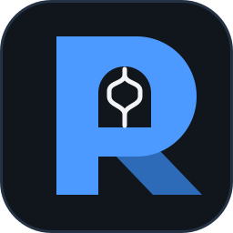
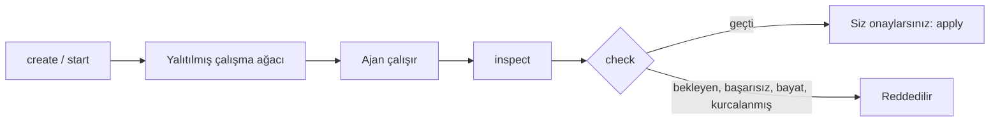

<div align="center">



# Respected Orchestrator

### Ajanlar çalışır. Siz onaylamadan projenize hiçbir şey girmez.

Kodlama ajanlarını yalıtılmış Git çalışma ağaçlarında çalıştıran, sonucu denetleyen yerel AI görev motoru.

<br>

[](https://github.com/respected0/respected-orchestrator/releases)
[](LICENSE)


**Codex** · **Claude** · **Antigravity** · **Cursor** · **OpenCode** · **OpenRouter** · **kendi komutunuz**

[Nasıl çalışır](#nasıl-çalışır) · [Özellikler](#özellikler) · [Kurulum](#kurulum) · [Komutlar](#komutlar) · [Geliştirme](#geliştirme)

</div>

---

## Nasıl çalışır

Ajan, projenizin kendisinde değil, **yalıtılmış bir Git çalışma ağacında** çalışır. Sonuç denetimden geçer; siz onaylamadan projenize
hiçbir şey uygulanmaz.



`check` şunları denetler: **kapsam**, **doğrulama komutları**, **imzalı kanıt** ve **yamanın güncelliği**.

Brain, not kasası, Hub ya da sürekli çalışan bir servis gerektirmez; Brain hafızası isteğe bağlıdır.

## Özellikler

| | |
|---|---|
| **Yalıtım** | Her görev projenizin ayrı bir Git çalışma ağacında ve bir Windows AppContainer içinde çalışır; gerçek ağaca dokunmaz, ağ varsayılan kapalıdır |
| **Kendi ajanınız** | Codex, Claude, Antigravity, Cursor, OpenCode, OpenRouter (API; anahtar Windows DPAPI kasasında, ağ yalnızca sizin açmanızla) ya da kendi komutunuz |
| **Denetim** | Kapsam, doğrulama komutları, imzalı kanıt, yamanın güncelliği |
| **Onay sizde** | Hiçbir sonuç kendiliğinden uygulanmaz; bekleyen, başarısız, bayat ya da kurcalanmış sonuç `check`'ten geçmez |
| **Kampanyalar ve projeler** | Çok adımlı işler için MAF iş akışı, bağımlılık (DAG) tabanlı scheduler ve paralel hatlar, planlayıcı, `coordinator` ve `tester` rolleri, iki sonucu güvenle birleştirme (`integrate`), çökme sonrası kontrollü devam (`project-resume`) |
| **Her model her role** | Rol ataması açık seçim, Hub varsayılanı ve ölçülmüş geçmişe dayalı otomatik öneri sırasıyla çözülür; açık seçim sessizce değiştirilmez |
| **AI araçlarına MCP** | Orchestrator, AI araçlarına MCP sunucusu olarak kaydedilebilir |
| **Brain hafızası (isteğe bağlı)** | Brain kuruluysa ve izin verirseniz hafızadan okur, kalıcı kararları Brain'e not olarak bırakır |

## Kurulum

`RespectedOrchestrator-Windows-Setup.exe` kullanıcı başına kurulur, **yönetici izni istemez, Python gerektirmez**. Bilgisayarda **Git** ve
görevleri yapacak bir AI aracının komut satırı (oturumu açık) olmalıdır. Kurucu iki yol sunar:

- **Respected Hub ile devam et:** Hub'ı kurar ve Orchestrator'ı Hub'da açar.
- **Yalnızca Orchestrator**

Kurucuyu yeniden çalıştırmak onarır/günceller, ayarları değiştirir ya da kaldırır. Adım adım: [Kullanım rehberi](docs/USAGE.md).

**Güncelleme:** eski sürümden güncellerken ayarlarınız ve önceki görev kayıtlarınız korunur; biçimi değişen ayarlar otomatik taşınır ve eskisi `.bak` olarak saklanır. beta.2 ile Gemini CLI desteği kalktı (Google'ın aracı Antigravity oldu): `gemini` olarak ayarlanmış varsayılanlar `agy`'ye çevrilir, eski Gemini MCP kaydı `integrations set gemini=off` ya da kaldırma ile temizlenir.

**Kurulumdan sonra bir adım:** kullandığınız AI aracını yeniden başlatın ve aracın ilgili yerinden (eklentiler, MCP) Orchestrator'a izin verin. Yoksa araç Orchestrator'ı görmez.

| Ne | Nerede |
|---|---|
| Program | `%LOCALAPPDATA%\Respected\RespectedOrchestrator\app\respected-orchestrator.exe` (kurucunun) |
| Ayarlar, görev çalışmaları, kanıtlar | `%LOCALAPPDATA%\Respected\RespectedOrchestrator\data` |

Beta yalnızca Windows'u destekler. Kurucu henüz Authenticode ile imzalı değildir; Windows SmartScreen uyarı gösterebilir.

## Komutlar

Hepsi JSON yazar; hata `{"error": {"code", "message", "hint"}}`, çıkış kodu `0` başarı, `1` başarısız, `2` kullanım.
Tam liste ve istek biçimleri: [docs/COMMANDS.md](docs/COMMANDS.md).

| Alan | Komutlar |
|---|---|
| **Kurulum ve bakım** | `setup`, `repair`, `uninstall [--purge]`, `config [get\|set]`, `health`, `status` |
| **Bağlantılar** | `memory connect [--write] \| disconnect \| status` (Brain hafızası), `integrations [set İSTEMCİ=on\|off]` (AI araçlarına MCP kaydı), `provider-key`, `provider-models` (OpenRouter), `mcp`, `rpp` |
| **Görevler** | `create` → `start` → `inspect` → `check` → `apply`; ayrıca `list`, `retry`, `cancel`, `artifact`, `evidence`, `maf`, `maf-approve`, `roles`, `plan`, `coordinate`, `integrate` |
| **Projeler ve kampanyalar** | `project-start\|status\|resume\|approve\|cancel`, `campaign-start\|status\|cancel\|list` |
| **GitHub** | `github-import-issue`, `github-pr-plan`, `github-pr-create`, `github-ci-plan` |

## Geliştirme

```powershell
python -m pip install -e ".[dev]"
python -m unittest discover -s tests -t .              # geçici depolar ve sahte çalışanlar; HOME yalıtılır
python packaging/build_dist.py                         # dist\RespectedOrchestrator\respected-orchestrator.exe
python -m unittest tests.packaging.test_frozen_build   # derlenmiş program, PATH'te Python yokken
python packaging/build_installer.py                    # dist\RespectedOrchestrator-Windows-Setup.exe
$env:RESPECTED_DATA_DIR = "$env:TEMP\orch-dev"; python -m respected_orchestrator status
```

<details>
<summary><b>Kaynak düzeni</b></summary>

<br>

| Yol | İçerik |
|---|---|
| `src/respected_orchestrator/engine/` | Çalışma ağaçları, çalıştırıcı, araç katmanları (Codex, OpenCode, OpenRouter…), AppContainer kum havuzu, süreç denetimi, belirteç bütçesi, anahtar kasası |
| `src/respected_orchestrator/workflows/` | MAF iş akışı, kampanyalar, projeler, planlayıcı, coordinator, checkpoint, rol atama |
| `src/respected_orchestrator/interfaces/` | RPP, kurulum ve veri geçişi, MCP sunucusu ve istemcisi, GitHub, Brain hafızası, AI aracı kayıtları |
| `packaging/windows/orchestrator_setup.iss` | Kurucu |

</details>

## Belgeler

| Belge | Konu |
|---|---|
| [USAGE.md](docs/USAGE.md) | Kullanım rehberi |
| [COMMANDS.md](docs/COMMANDS.md) | Komutlar ve istek biçimleri |
| [ARCHITECTURE.md](docs/ARCHITECTURE.md) | Bağlayıcı kurallar ve güvenlik sınırları |
| [adr/](docs/adr) | Mimari karar kayıtları (ADR-001…020): neden böyle yapıldı |
| [THREAT_MODEL.md](docs/THREAT_MODEL.md) | Tehdit modeli ve yetki matrisi |
| [PRODUCT_CONTRACT.md](docs/PRODUCT_CONTRACT.md) | Üç ürünün ortak sözleşmesi |
| [ROADMAP.md](docs/ROADMAP.md) | Yol haritası |
| [PRIVACY.md](PRIVACY.md) | Hangi veri nerede durur, neresi dışarı çıkar |
| [FOOTPRINT.md](docs/FOOTPRINT.md) | Ne yaparsanız nerede ne oluşur: kurulum, AI araçları, kaldırma |

Ekosistemin diğer ürünleri: [Respected Hub](https://github.com/respected0/respected-hub) ·
[Respected Brain](https://github.com/respected0/respected-brain).

## Destek

Hata bildirimi ve sorular için [GitHub Issues](https://github.com/respected0/respected-orchestrator/issues).

## Lisans

[MIT lisansı](LICENSE).
